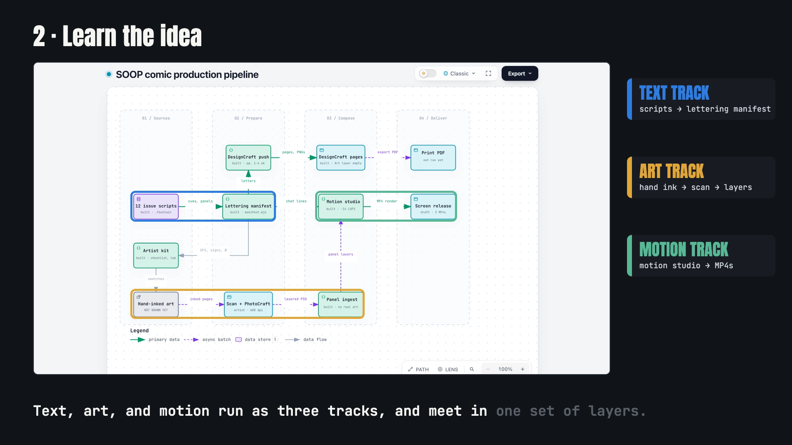

# Building a comic book pipeline with AI

A written guide, for anyone (person or AI agent) who has an artist's comic scripts and wants a code-driven production pipeline: it walks you from interviewing the artist to lettered print pages and motion pieces, one tested phase at a time. It is a guide, not software: the pipeline code it describes is not in this repo.

[](https://nojuannobody.github.io/comic-pipeline-guide/explainer/explainer.mp4)

[▶ Watch the 60-second explainer](https://nojuannobody.github.io/comic-pipeline-guide/explainer/explainer.mp4) · [Read the one-page explainer](https://nojuannobody.github.io/comic-pipeline-guide/explainer/)

**How it works for you**

1. Read "What is real and what isn't" first: a table of what was built, tested, or never run.
2. Read "The idea" and "How it works": text, art and motion run as three tracks that meet in one set of layers.
3. Have your agent interview the artist (32 questions) and label every answer DECIDED, WORKING ASSUMPTION or OPEN.
4. Paste the appendix brief, with the guide, into your agent's first message.
5. Work through Phases 0–13; each ends with a "done when" test. Finish with the 10-item acceptance checklist.

Status: the guide is published. The pipeline it describes works end to end on labelled stand-ins; no real panel art has gone through it yet.

---

A guide, for humans and AI agents, to building a code-driven comic production pipeline: scripts become lettering, panels become layers, and the same layers become print pages and motion pieces. It includes an interview script an agent can use with the artist first, and it says plainly what was and was not verified.

- Read it: the site's `index.html`, live at https://nojuannobody.github.io/comic-pipeline-guide/
- PDF: `guide.pdf`
- Diagrams: `diagrams/`

## Rebuild

The page is generated from the article's Markdown. `build.mjs` reads it from `../article/building-a-comic-pipeline-with-ai.md`, one level above this repo, and that file is not committed here, so a fresh clone cannot rebuild `index.html`. With the article in place:

```
npm install
node build.mjs          # writes index.html
SITE_URL=https://example.github.io/repo node build.mjs   # sets the social-preview URLs
```

All rights reserved unless a licence is added.
